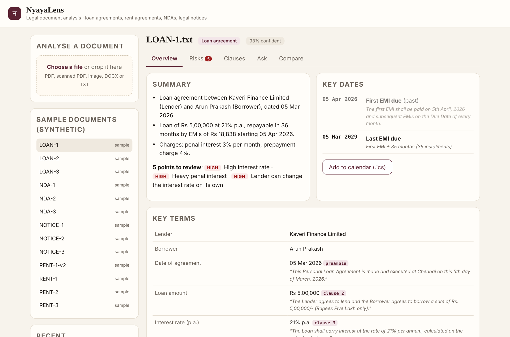
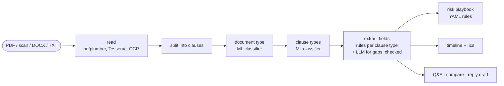

# NyayaLens: AI Legal Document Analysis Assistant

NyayaLens reads Indian legal documents (loan agreements, rent and lease agreements, NDAs and legal notices),
including scanned PDFs, and turns them into something a non-lawyer can act on:

- key terms and dates, each with the exact sentence it came from;
- risky or missing clauses, with the reason and the clause quoted;
- deadlines you can add to your calendar;
- answers to plain-English questions, citing the clause;
- a comparison of two versions of the same document;
- a first draft of a reply to a legal notice, for an advocate to review.

> **About this project.** This is my own project, built from scratch. Every document, party and amount in
> `data/` is fictional. NyayaLens highlights points for review; it is **not legal advice**.



More screenshots: [risk review](docs/risks.png) · [questions](docs/ask.png) ·
[version comparison](docs/compare.png) · [reply draft](docs/reply.png)

## How it works



1. **Read.** Text PDFs are read with pdfplumber. Pages with no text layer (scans, photos) go through
   Tesseract OCR. DOCX and plain text are also supported.
2. **Split into clauses** at numbered paragraphs, keeping the preamble (parties, date) and the closing
   block. Every result can then cite "clause 5".
3. **Classify** with two scikit-learn models: TF-IDF on words and character n-grams, plus logistic
   regression.
   - The **document type** model chooses among 4 types, and says "unknown" when unsure.
   - The **clause type** model chooses among 30 labels, such as interest, deposit, non-compete, demand
     and consequences.

   Both are trained at start-up on synthetic examples generated from separate templates
   (`scripts/make_training_data.py`), and show their confidence.
4. **Extract fields** by looking only in the right clause: the interest rate in the `interest` clause, the
   deposit in the `deposit` clause. The parsers understand Indian formats, such as Rs 5,00,000/-, "45 lakh",
   "3% per month" (converted to 36% p.a.), dd/mm/yyyy dates and "one month's notice". Every value keeps its
   quote. With an LLM configured, the model may fill only the fields the rules missed, and its answer is
   accepted only if the quote is really in the document and the value can be re-read from that quote.
5. **Review** with a playbook in `data/playbook.yaml`, which holds thresholds and rules a legal team can
   edit without touching code. Examples:
   - interest above 18%, or penal interest above 24% p.a.;
   - the lender can change the rate at its sole discretion;
   - a deposit of more than 6 months' rent;
   - a one-sided termination clause;
   - a non-compete that runs after the contract ends;
   - an unlimited indemnity;
   - fewer than 15 days given to reply to a notice, or a deadline that has already passed.
6. **Dates.** Works out the last EMI, when the lock-in ends, the last day to give notice and the deadline
   to reply to a notice, and exports them as a calendar file with reminders.
7. **Q&A, compare and reply.** Answers cite clauses. Version comparison shows changed terms, a word-level
   diff of each clause, and new or resolved risks. Reply drafts use placeholders for anything the notice
   does not state. LLM output is rejected if it mentions any amount, rate or date that is not in the
   document.

Before any text is sent to an LLM, phone numbers, emails, Aadhaar, PAN and account numbers are masked.

## Evaluation

The evaluation uses 12 hand-labelled documents (`eval/labels.json`) and 23 questions (`eval/qa.json`).
None of these documents is used for training.

| Metric | Offline (no LLM) |
|---|---|
| Document type | 12/12 |
| Clause type | 80/82 (97.6%) |
| Fields (incl. "not stated" fields that must stay empty) | 96/96 |
| Parties | 18/18 |
| Risk flags: precision / recall | 100% / 100% (23 flags) |
| Key dates | 14/14 |
| Q&A (right clause cited and fact present; out-of-document questions declined) | 23/23 |

The two clause errors are listed in the report: a confidentiality clause read as non-compete, and a
notices clause read as definitions. The labels, questions and rules were written together with the
system, so these scores show it works on its own documents. New, unseen documents will be harder.

CI runs the tests, including OCR on a scanned PDF, gates on these metrics, and builds the Docker image,
starts it and analyses the scanned notice.

## Run it

```bash
cp .env.example .env          # optional: add OPENAI_API_KEY
docker compose up --build
```

Open http://localhost:8000 and pick a sample document on the left, or upload your own. The API docs
are at http://localhost:8000/docs.

With no API key, everything runs offline. With `OPENAI_API_KEY`, `gpt-4.1-mini` fills gaps, summarises
and answers questions, and `gpt-4.1` drafts replies. Azure OpenAI (`LLM_PROVIDER=azure`) and Amazon
Bedrock (`LLM_PROVIDER=bedrock`, Nova Lite / Nova Pro) are also supported.

Locally:

```bash
pip install -r requirements-dev.txt     # Tesseract must be installed for scanned documents
make test
make eval
make run
```

## API

| Method | Path | Purpose |
|---|---|---|
| POST | `/analyze` | Upload a file (PDF, scan, image, DOCX, TXT) |
| POST | `/analyze/text` | Analyse pasted text |
| GET | `/analyses/{id}` | Full result: type, clauses, fields with quotes, risks, timeline, summary |
| POST | `/analyses/{id}/ask` | Question about the document |
| GET | `/analyses/{id}/calendar.ics` | Key dates as a calendar file |
| POST | `/analyses/{id}/reply` | Draft reply to a legal notice |
| GET | `/compare?a=&b=` | Compare two versions |

## Tech

Python, scikit-learn, FastAPI, OpenAI / Azure OpenAI / Amazon Bedrock, pdfplumber, Tesseract OCR,
python-docx, SQLite, Docker, GitHub Actions, pytest.

## Limitations

- It covers four document types, written in English, with numbered clauses.
- The training data is synthetic. Real documents vary more, and a production system would retrain on
  labelled real documents, ideally with a fine-tuned transformer for clause classification.
- The checklist is a starting point written for this demo, not a legal standard.
- There is no login, because this is a single-user demo.
